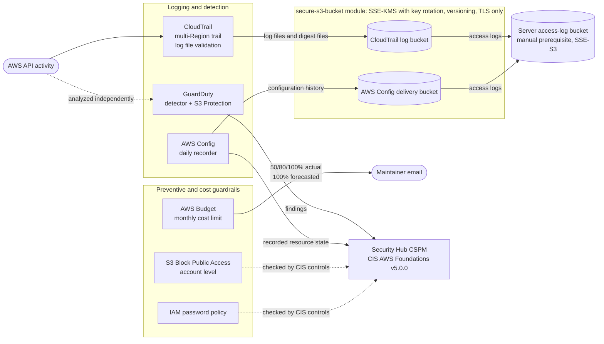

# aws-secure-baseline

[](https://github.com/wolfb1g/aws-secure-baseline/actions/workflows/ci.yml)

A Terraform security baseline for a single AWS account, built as a Cloud Security portfolio project. Each control was delivered in its own small, reviewable pull request with a security rationale, least-privilege policies, secure defaults, and the read-only checks that prove it works after deployment.

## Controls

**Status** means the Terraform for the control is merged and passes the static checks in CI (formatting, validation, Checkov, Gitleaks). **Verified by maintainer** records the read-only checks in [How each control is verified](#how-each-control-is-verified), run by the maintainer after deploying to the lab account.

| Control | What it enforces | Status | Verified by maintainer |
| --- | --- | --- | --- |
| AWS Budget | Monthly cost budget with alerts at 50%, 80%, and 100% of actual spend and 100% of forecasted spend | Implemented in code | Pending |
| Account-level S3 Block Public Access | All four Block Public Access settings for every bucket in the account | Implemented in code | Pending |
| IAM password policy | CIS-aligned IAM user passwords: 14+ characters, four character classes, 24-password history, no forced expiration | Implemented in code | Pending |
| Reusable secure S3 bucket module | Private, versioned, TLS-only log buckets with a customer managed KMS key (rotation on) and server access logging | Implemented in code | Pending |
| CloudTrail | Multi-Region management-event trail with global service events, log file validation, and KMS encryption | Implemented in code | Pending |
| GuardDuty | Threat detection with S3 Protection; every other paid protection plan off by default | Implemented in code | Pending |
| AWS Config | Daily resource recording with the service-linked role, delivered to an encrypted module bucket | Implemented in code | Pending |
| Security Hub + CIS AWS Foundations | Security Hub CSPM with default standards off and an explicit CIS AWS Foundations Benchmark v5.0.0 subscription | Implemented in code | Pending |

AWS now calls the classic Security Hub capability **AWS Security Hub CSPM**; the `aws_securityhub_*` resources in this repository manage it.

## Architecture



- **Logs:** CloudTrail delivers management events from every Region, plus hourly digest files for integrity validation, to its own bucket. AWS Config delivers configuration history to a separate bucket. Each bucket has its own customer managed KMS key, and both send S3 server access logs to a separate access-log bucket.
- **Findings:** GuardDuty analyzes CloudTrail management events, VPC Flow Logs, DNS logs, and S3 data events from its own independent streams (it does not read the trail bucket) and sends findings to Security Hub CSPM. Security Hub evaluates the CIS controls through AWS Config rules: change-triggered checks use the resource state that AWS Config records, and periodic checks cover account settings such as S3 Block Public Access and the IAM password policy.
- **Least privilege:** the bucket and key policies grant CloudTrail and AWS Config only the actions they need, restricted with `aws:SourceArn` (CloudTrail) or `aws:SourceAccount` (AWS Config, as AWS documents), and deny any request without TLS 1.2 or later.
- **Scope:** GuardDuty, AWS Config, Security Hub, the KMS keys, and the buckets are regional (`aws_region`); the trail covers all Regions. Budget alerts go to the email address set in the local, uncommitted `terraform.tfvars`.

## Repository layout

```text
.
├── .github/workflows/ci.yml         # Credential-free validation and security checks
├── docs/
│   └── PROJECT_BRIEF.md             # Project scope, roadmap, and definition of done
├── modules/
│   └── secure-s3-bucket/            # Private, KMS-encrypted S3 bucket with secure defaults
├── environments/
│   └── dev/
│       ├── .terraform.lock.hcl     # Committed provider version and checksums
│       ├── providers.tf            # Terraform, provider, backend, and tags
│       ├── data.tf                 # Current account, partition, and Region lookups
│       ├── variables.tf            # Region, environment, and control inputs
│       ├── main.tf                 # Per-control environment layout notes
│       ├── budget.tf               # Monthly AWS cost budget and threshold alerts
│       ├── cloudtrail.tf           # Multi-region CloudTrail and KMS-encrypted log bucket
│       ├── config.tf               # AWS Config recorder, KMS-encrypted delivery bucket, and SLR
│       ├── guardduty.tf            # GuardDuty detector, S3 protection, and optional feature toggles
│       ├── iam_password_policy.tf  # CIS-aligned IAM account password policy
│       ├── s3_public_access.tf     # Account-level S3 Block Public Access settings
│       ├── securityhub.tf          # Security Hub account and CIS AWS Foundations subscription
│       └── terraform.tfvars.example
├── .gitignore
├── AGENTS.md                       # Contributor and agent rules
└── README.md
```

## Prerequisites

- Terraform `~> 1.16.4` (at least 1.16.4 and below 1.17.0).
- HashiCorp AWS provider `~> 6.0` (6.x), installed by `terraform init`; the committed lock file records the selected version.
- Checkov `3.3.20` and Gitleaks `8.30.1` installed locally to match CI.
- Network access to the Terraform Registry and provider distribution endpoints for initialization.

AWS credentials are not available in the development environment and are not needed for the static checks below.

## Quick start

Run from the repository root:

```sh
terraform fmt -check -recursive
terraform -chdir=environments/dev init -backend=false
terraform -chdir=environments/dev validate
```

Initialization downloads providers without initializing a state backend. Validation checks configuration syntax and provider schemas without calling AWS APIs. These commands do not provision resources.

`plan` and `apply` require AWS credentials and are out of scope for CI. Contributor and agent rules prohibit running `plan`, `apply`, or `destroy` in the development environment and prohibit calling AWS APIs.

The example variables file contains placeholders only. Static `validate` runs without a `.tfvars` file (using defaults where defined, such as `us-east-1`, `dev`, `budget_monthly_limit_usd = 10`, `config_create_service_linked_role = true`, and `securityhub_cis_version = "5.0.0"`); deployment-only inputs such as `budget_alert_email`, `access_log_bucket_name`, `cloudtrail_bucket_name`, and `config_bucket_name` have no default and must be supplied in a gitignored local `terraform.tfvars` file when deployment is authorized.

## Deploy and tear down (maintainer only)

Agents never receive AWS credentials and never run `plan`, `apply`, or `destroy`. The maintainer runs these steps with credentials for the lab account.

### 1. Configure first

1. **Region.** Choose `aws_region` (default `us-east-1`). The regional services, KMS keys, and buckets are created there; the trail is multi-Region.
2. **Access-log bucket (manual prerequisite).** The `secure-s3-bucket` module sends S3 server access logs to an existing bucket that Terraform does not manage. Create it in the same Region with a globally unique name (new buckets already have Block Public Access on, ACLs disabled, and SSE-S3 default encryption) and attach a bucket policy that lets S3 log delivery write only for the two log buckets:

   ```json
   {
     "Version": "2012-10-17",
     "Statement": [
       {
         "Sid": "S3ServerAccessLogsPolicy",
         "Effect": "Allow",
         "Principal": { "Service": "logging.s3.amazonaws.com" },
         "Action": "s3:PutObject",
         "Resource": [
           "arn:aws:s3:::<access-log-bucket-name>/<cloudtrail-logs-bucket-name>/*",
           "arn:aws:s3:::<access-log-bucket-name>/<config-logs-bucket-name>/*"
         ],
         "Condition": {
           "ArnLike": {
             "aws:SourceArn": [
               "arn:aws:s3:::<cloudtrail-logs-bucket-name>",
               "arn:aws:s3:::<config-logs-bucket-name>"
             ]
           },
           "StringEquals": { "aws:SourceAccount": "<account-id>" }
         }
       }
     ]
   }
   ```

3. **Variables.** Copy `environments/dev/terraform.tfvars.example` to `environments/dev/terraform.tfvars` (gitignored) and set `aws_region`, `environment`, `budget_monthly_limit_usd`, `budget_alert_email` (never commit it), `access_log_bucket_name`, `cloudtrail_bucket_name`, and `config_bucket_name`. Bucket names must be globally unique and contain no dots. Keep `config_create_service_linked_role = true` unless `aws iam get-role --role-name AWSServiceRoleForConfig` shows that the role already exists. Leave the optional GuardDuty plans set to `false`.

### 2. Apply in this order

```sh
terraform -chdir=environments/dev init
# 1. Cost guardrail first, before any billable service exists.
terraform -chdir=environments/dev apply -target=aws_budgets_budget.monthly_cost
# 2. Everything else. Review the plan before confirming.
terraform -chdir=environments/dev apply
```

Terraform orders the second apply: the CloudTrail bucket, bucket policy, and key policy before the trail; the AWS Config role, bucket, recorder, and delivery channel before recording starts; and AWS Config before Security Hub and the CIS subscription. Terraform warns that `-target` is for exceptional use; the full apply that follows converges the whole configuration.

The local state file (`environments/dev/terraform.tfstate`) contains the alert email and resource identifiers. It is gitignored; never commit or share it.

### 3. Tear down after testing

The GuardDuty and Security Hub trials start at apply, and the KMS keys and AWS Config bill from day one. Run `terraform destroy` when verification is complete:

```sh
terraform -chdir=environments/dev destroy
```

- The CloudTrail and AWS Config log buckets keep `force_destroy = false` so Terraform never deletes audit logs on its own. `destroy` stops with `BucketNotEmpty` while they contain logs: once you no longer need the logs, empty both buckets (all object versions) with **Empty** in the S3 console, then run `destroy` again.
- The two KMS keys are scheduled for deletion with a 30-day waiting period.
- Delete the manually created access-log bucket last.

## How each control is verified

Run these read-only checks with the lab account credentials after `apply`. Agents never run them.

```sh
export AWS_REGION="<aws-region>"
ENVIRONMENT="dev"
ACCOUNT_ID="$(aws sts get-caller-identity --query Account --output text)"
```

1. **AWS Budget**

   ```sh
   aws budgets describe-budget --account-id "$ACCOUNT_ID" --budget-name "${ENVIRONMENT}-monthly-cost-budget"
   aws budgets describe-notifications-for-budget --account-id "$ACCOUNT_ID" --budget-name "${ENVIRONMENT}-monthly-cost-budget"
   ```

   Expect a `COST` budget with `TimeUnit` `MONTHLY` and your limit, and four notifications: `ACTUAL` at 50, 80, and 100 percent and `FORECASTED` at 100 percent. Console: **Billing and Cost Management → Budgets**.

2. **Account-level S3 Block Public Access**

   ```sh
   aws s3control get-public-access-block --account-id "$ACCOUNT_ID"
   ```

   Expect `BlockPublicAcls`, `IgnorePublicAcls`, `BlockPublicPolicy`, and `RestrictPublicBuckets` all `true`. Console: **S3 → Block Public Access settings for this account**.

3. **IAM password policy**

   ```sh
   aws iam get-account-password-policy
   ```

   Expect `MinimumPasswordLength` `14`, `PasswordReusePrevention` `24`, all four `Require*` flags `true`, `AllowUsersToChangePassword` `true`, and `ExpirePasswords` `false`. Console: **IAM → Account settings**.

4. **Secure log buckets (module)** — run for both `<cloudtrail-logs-bucket-name>` and `<config-logs-bucket-name>`:

   ```sh
   BUCKET="<cloudtrail-logs-bucket-name>"
   aws s3api get-bucket-encryption --bucket "$BUCKET"
   aws s3api get-bucket-versioning --bucket "$BUCKET"
   aws s3api get-public-access-block --bucket "$BUCKET"
   aws s3api get-bucket-logging --bucket "$BUCKET"
   aws s3api get-bucket-policy --bucket "$BUCKET" --query Policy --output text
   KEY_ID="$(aws kms describe-key --key-id "alias/$BUCKET" --query KeyMetadata.KeyId --output text)"
   aws kms get-key-rotation-status --key-id "$KEY_ID"
   ```

   Expect `aws:kms` default encryption with `BucketKeyEnabled` `true`, versioning `Enabled`, all four public-access blocks `true`, access logs going to the access-log bucket, a policy that denies non-TLS and TLS below 1.2 and allows only the owning service, and `KeyRotationEnabled` `true`.

5. **CloudTrail**

   ```sh
   TRAIL_NAME="${ENVIRONMENT}-management-trail"
   aws cloudtrail describe-trails --trail-name-list "$TRAIL_NAME"
   aws cloudtrail get-trail-status --name "$TRAIL_NAME"
   aws cloudtrail get-event-selectors --trail-name "$TRAIL_NAME"
   TRAIL_ARN="$(aws cloudtrail describe-trails --trail-name-list "$TRAIL_NAME" --query 'trailList[0].TrailARN' --output text)"
   aws cloudtrail validate-logs --trail-arn "$TRAIL_ARN" --start-time "<ISO-8601 time after the trail was created>"
   ```

   Expect `IsMultiRegionTrail`, `IncludeGlobalServiceEvents`, and `LogFileValidationEnabled` `true` with `KmsKeyId` set; `IsLogging` `true` and no `LatestDeliveryError`; management events only (`ReadWriteType` `All`, no data resources); and, about an hour after the first delivery, `validate-logs` reporting the digest and log files as valid. Console: **CloudTrail → Trails**.

6. **GuardDuty**

   ```sh
   DETECTOR_ID="$(aws guardduty list-detectors --query 'DetectorIds[0]' --output text)"
   aws guardduty get-detector --detector-id "$DETECTOR_ID" \
     --query '{Status: Status, Frequency: FindingPublishingFrequency, Features: Features[].{Name: Name, Status: Status}}'
   ```

   Expect `Status` `ENABLED`, `Frequency` `FIFTEEN_MINUTES`, `S3_DATA_EVENTS` `ENABLED`, and `EKS_AUDIT_LOGS`, `EBS_MALWARE_PROTECTION`, `RDS_LOGIN_EVENTS`, `LAMBDA_NETWORK_LOGS`, `RUNTIME_MONITORING`, and `AI_PROTECTION` `DISABLED`. Any other feature in the list (such as the `AI_ANALYST` preview) is not managed by this baseline. Console: **GuardDuty → Protection plans**.

7. **AWS Config**

   ```sh
   aws configservice describe-configuration-recorders
   aws configservice describe-configuration-recorder-status
   aws configservice describe-delivery-channels
   aws configservice describe-delivery-channel-status
   ```

   Expect the `${ENVIRONMENT}-recorder` recorder with the `AWSServiceRoleForConfig` role, `allSupported` and `includeGlobalResourceTypes` `true`, and `recordingFrequency` `DAILY`; `recording` `true`; and the `${ENVIRONMENT}-delivery-channel` pointing at the AWS Config bucket and its KMS key, with `SUCCESS` as the last history delivery status once the first delivery has run. Console: **AWS Config → Settings**.

8. **Security Hub CSPM and CIS AWS Foundations Benchmark**

   ```sh
   aws securityhub describe-hub
   aws securityhub get-enabled-standards
   aws securityhub list-enabled-products-for-import
   aws securityhub get-findings --max-items 20 \
     --filters '{"ComplianceStatus":[{"Value":"FAILED","Comparison":"EQUALS"}],"RecordState":[{"Value":"ACTIVE","Comparison":"EQUALS"}]}' \
     --query 'Findings[].{Control: Compliance.SecurityControlId, Title: Title}'
   ```

   Expect `AutoEnableControls` `true` and `ControlFindingGenerator` `SECURITY_CONTROL`; only `standards/cis-aws-foundations-benchmark/v/5.0.0` enabled, with `StandardsStatus` `READY`; and the GuardDuty product subscription listed. CIS control findings appear after AWS Config finishes its first recording cycle, which can take several hours. A fresh lab account will not score 100%: CloudTrail.5 (CloudWatch Logs integration) fails by design because that integration is out of scope for cost, and controls for account settings outside this baseline, such as root user MFA, depend on the account. Console: **Security Hub CSPM → Security standards**.

## Cost

Estimates for an idle lab account in one Region; actual cost depends on activity and resource count. Check Cost Explorer and the budget alerts.

| Control | Cost | Cost-control choices |
| --- | --- | --- |
| AWS Budget | Free | Email notifications only; no budget actions. |
| Account-level S3 Block Public Access | Free | — |
| IAM password policy | Free | — |
| CloudTrail | First copy of management events free; about USD 1/month for the KMS key; cents for S3 storage | Management events only; data events and CloudWatch Logs delivery left out. S3 Bucket Keys reduce KMS requests. |
| GuardDuty | **30-day free trial that starts at apply**; then usage-based, typically a few USD per month or less when idle | S3 Protection only; EKS, EBS malware, RDS, Lambda, Runtime Monitoring, and AI Protection plans are off by default. |
| AWS Config | USD 0.012 per configuration item with daily recording; about USD 1/month for the KMS key; cents for S3 storage | Daily periodic recording instead of continuous recording, so frequent changes within a day do not multiply charges. |
| Security Hub + CIS AWS Foundations | **30-day free trial that starts at apply**; then USD 0.0010 per security check for the first 100,000 checks per month | Default standards off; only CIS v5.0.0 is evaluated. |

Estimated total: about USD 2–4 per month while the trials run (two KMS keys, AWS Config items, and storage), and roughly USD 4–10 per month after the trials. The default USD 10 budget alerts at 50%, 80%, and 100%. Trials apply once per account and Region.

**Run `terraform destroy` after testing** (see [Tear down after testing](#3-tear-down-after-testing)); otherwise GuardDuty and Security Hub start billing when their trials end, and the KMS keys and AWS Config keep billing.

## Security principles

- Keep secrets, AWS account IDs, real-account ARNs, and Terraform state out of version control.
- Use variables and placeholders for deployment-specific data; never embed credentials.
- Design each control with least privilege and a documented security rationale.
- Commit `.terraform.lock.hcl` and constrain Terraform and provider versions for reproducible checks.
- Keep downloaded providers and local configuration ignored by Git.
- Use a local backend for this lab. The commented [S3 backend example](https://developer.hashicorp.com/terraform/language/backend/s3) is a future option with encryption and native state locking; it must remain disabled during static checks.

## Continuous integration

The [CI workflow](.github/workflows/ci.yml) runs on pull requests and on pushes to `main`. Three independent jobs fail on formatting errors, invalid Terraform, security findings, or detected secrets:

- **Terraform:** Terraform `1.16.4` checks formatting recursively, then initializes with `-backend=false -input=false` and validates every directory containing `.tf` files under `environments/` and `modules/`. Downloaded `.terraform/` directories are excluded; future roots and modules are discovered automatically.
- **Checkov:** Checkov `3.3.20` scans the whole repository for Terraform and GitHub Actions findings, with soft failure explicitly disabled. Any resource-specific exceptions require inline justifications and documentation in the relevant README.
- **Gitleaks:** Gitleaks `8.30.1` scans the complete Git history with redacted output. Its release archive is verified against the release's SHA256 checksums before extraction; no Gitleaks action license is required.

Every action is pinned to a full commit SHA with its release tag recorded inline. Jobs have timeouts, the workflow grants only `contents: read`, checkout does not persist credentials, and newer runs cancel earlier runs for the same ref. The workflow needs no AWS credentials and does not authenticate to or call AWS.

To reproduce the CI checks locally with the versions above, run from the repository root:

```sh
terraform fmt -check -recursive
while IFS= read -r directory; do
  terraform -chdir="$directory" init -backend=false -input=false || exit
  terraform -chdir="$directory" validate || exit
done < <(
  find environments modules -type d -name .terraform -prune -o \
    -type f -name '*.tf' -exec dirname {} \; | sort -u
)
checkov -d . --framework terraform,github_actions --quiet --compact
gitleaks git --redact --verbose .
gitleaks dir --redact .
```

Use Bash for the loop. The additional directory scan checks uncommitted files before a commit; CI's Git scan covers committed history. Passing CI verifies these static checks, not deployed AWS controls or account compliance.

## Pipeline demo

Draft PR [#19 — demo: insecure public S3 bucket blocked by CI (DO NOT MERGE)](https://github.com/wolfb1g/aws-secure-baseline/pull/19) adds `demo/insecure-s3-bucket/main.tf`: a clearly commented S3 bucket with all four Block Public Access settings off, a bucket policy that lets anyone read every object, and no encryption configuration. On that PR the Checkov job fails with 12 failed checks, including `CKV_AWS_53`–`CKV_AWS_56` and `CKV2_AWS_6` (public access blocks), `CKV_AWS_70` (a policy that allows any principal), and `CKV_AWS_145` (no KMS default encryption), while the formatting, validation, and secret-scanning jobs pass.

It proves that the security gate runs on every pull request without AWS credentials, that an insecure change is stopped before it reaches `main` rather than found after deployment, and that the gate is not weakened (soft fail disabled, no global skips, and every exception inline with a justification). The PR stays open as evidence and is never merged.

## Checkov exceptions

No global skips are configured. Environment-level checks skipped inline:

| Check | Resource | Justification |
| --- | --- | --- |
| `CKV_AWS_9` | `aws_iam_account_password_policy.this` (`environments/dev/iam_password_policy.tf`) | Forced periodic expiration is intentionally omitted. NIST SP 800-63B-4 (July 2025) Section 3.1.1.2 states that verifiers SHALL NOT require periodic password changes and SHALL force a change only when there is evidence of compromise. The CIS AWS Foundations Benchmark v5.0.0 has no password-expiration recommendation; the 90-day check (Security Hub control IAM.17) maps only to CIS v1.2.0. |
| `CKV_AWS_252` | `aws_cloudtrail.this` (`environments/dev/cloudtrail.tf`) | SNS topic notifications for CloudTrail log delivery are out of scope per `docs/PROJECT_BRIEF.md` Section 3. |
| `CKV2_AWS_10` | `aws_cloudtrail.this` (`environments/dev/cloudtrail.tf`) | CloudWatch Logs integration is out of scope per `docs/PROJECT_BRIEF.md` Section 3 to avoid ongoing log ingestion and storage costs; management events are delivered to a KMS-encrypted S3 bucket with log file validation. |
| `CKV2_AWS_3` | `aws_guardduty_detector.this` (`environments/dev/guardduty.tf`) | AWS Organizations GuardDuty configuration (`aws_guardduty_organization_configuration`) is out of scope because this baseline targets a single standalone AWS account per `docs/PROJECT_BRIEF.md` Sections 1 and 3. |

Module-level skips (`CKV_AWS_144` and `CKV2_AWS_62` on the bucket, and `CKV_AWS_109`, `CKV_AWS_111`, and `CKV_AWS_356` on the KMS key policy document) are justified in [modules/secure-s3-bucket/README.md](modules/secure-s3-bucket/README.md#checkov-exceptions).

## Lessons learned

_To be written by the maintainer after deploying and verifying the baseline._

## Roadmap and current status

All planned controls are implemented in code and pass the static checks in CI. Deployment and verification in the lab account are pending; the maintainer records them in the **Verified by maintainer** column. Static checks do not establish that an AWS account meets any security standard.

The stretch items in `docs/PROJECT_BRIEF.md` (an IAM Access Analyzer external access analyzer, and an EventBridge rule that sends high-severity GuardDuty findings to an SNS email topic) are not started. Future work uses one draft PR per security control, opened only after the previous one is merged (no stacking), with test instructions and security considerations in every description.
