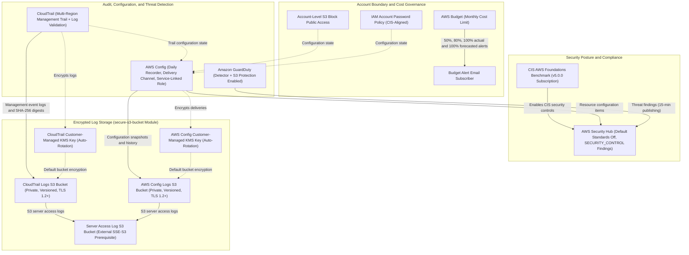

# aws-secure-baseline

[](https://github.com/wolfb1g/aws-secure-baseline/actions/workflows/ci.yml)

A Terraform security baseline for a single AWS account, built as a Cloud Security portfolio project. The goal is to demonstrate repeatable security controls, least-privilege design, explicit cost guardrails, and verifiable infrastructure changes through small, reviewable PRs.

## Controls

`Implemented` indicates that the Terraform configuration and static security checks are in place in this repository; live account enforcement requires human maintainer `terraform plan` and `terraform apply` verification in the target AWS account.

| Control | Purpose | Status |
| --- | --- | --- |
| AWS Budget | Track spending against an explicit budget and alert on thresholds | Implemented |
| Account-level S3 Block Public Access | Prevent public access to S3 at the account boundary | Implemented |
| IAM password policy | Establish requirements for IAM user passwords | Implemented |
| Reusable secure S3 bucket module | Provide consistent bucket encryption, access restrictions, and secure defaults | Implemented |
| CloudTrail | Record account activity for auditing and investigation | Implemented |
| GuardDuty | Detect suspicious activity and potential threats | Implemented |
| AWS Config | Record resource configurations and changes for compliance evaluation | Implemented |
| Security Hub + CIS AWS Foundations | Aggregate findings and assess the account against the CIS AWS Foundations standard | Implemented |

## Architecture



## Repository layout

```text
.
├── .github/workflows/ci.yml         # Credential-free validation and security checks
├── docs/
│   └── PROJECT_BRIEF.md             # Project scope, roadmap, and definition of done
├── modules/
│   └── secure-s3-bucket/            # Private, KMS-encrypted S3 bucket with secure defaults
├── environments/
│   └── dev/
│       ├── .terraform.lock.hcl     # Committed provider version and checksums
│       ├── providers.tf            # Terraform, provider, backend, and tags
│       ├── data.tf                 # Current account, partition, and Region lookups
│       ├── variables.tf            # Region, environment, and control inputs
│       ├── main.tf                 # Per-control environment layout notes
│       ├── budget.tf               # Monthly AWS cost budget and threshold alerts
│       ├── cloudtrail.tf           # Multi-region CloudTrail and KMS-encrypted log bucket
│       ├── config.tf               # AWS Config recorder, KMS-encrypted delivery bucket, and SLR
│       ├── guardduty.tf            # GuardDuty detector, S3 protection, and optional feature toggles
│       ├── iam_password_policy.tf  # CIS-aligned IAM account password policy
│       ├── s3_public_access.tf     # Account-level S3 Block Public Access settings
│       ├── securityhub.tf          # Security Hub account and CIS AWS Foundations subscription
│       └── terraform.tfvars.example
├── .gitignore
├── AGENTS.md                       # Contributor and agent rules
└── README.md
```

## Prerequisites

- Terraform `~> 1.16.4` (at least 1.16.4 and below 1.17.0).
- HashiCorp AWS provider `~> 6.0` (6.x), installed by `terraform init`; the committed lock file records the selected version.
- Checkov `3.3.20` and Gitleaks `8.30.1` installed locally to match CI.
- Network access to the Terraform Registry and provider distribution endpoints for initialization.

AWS credentials are not available in the development environment and are not needed for the static checks below.

## Quick start

Run from the repository root:

```sh
terraform fmt -check -recursive
terraform -chdir=environments/dev init -backend=false
terraform -chdir=environments/dev validate
```

Initialization downloads providers without initializing a state backend. Validation checks configuration syntax and provider schemas without calling AWS APIs. These commands do not provision resources.

`plan` and `apply` require AWS credentials and are out of scope for CI. Contributor and agent rules prohibit running `plan`, `apply`, or `destroy` in the development environment and prohibit calling AWS APIs.

The example variables file contains placeholders only. Static `validate` runs without a `.tfvars` file (using defaults where defined, such as `us-east-1`, `dev`, `budget_monthly_limit_usd = 10`, `config_create_service_linked_role = true`, and `securityhub_cis_version = "5.0.0"`); deployment-only inputs such as `budget_alert_email`, `access_log_bucket_name`, `cloudtrail_bucket_name`, and `config_bucket_name` have no default and must be supplied in a gitignored local `terraform.tfvars` file when deployment is authorized (set `config_create_service_linked_role = false` if the account already has `AWSServiceRoleForConfig`). Prepare the separate server access-log destination bucket (`access_log_bucket_name`) beforehand as described in [modules/secure-s3-bucket/README.md](modules/secure-s3-bucket/README.md).

## How each control is verified

After the maintainer runs `terraform plan` and `terraform apply` in the lab AWS account, each control can be verified with read-only AWS CLI commands (or the equivalent AWS Console view). Agents never execute these commands.

Set shell placeholders before running the read-only checks:

```sh
ACCOUNT_ID="$(aws sts get-caller-identity --query Account --output text)"
AWS_REGION="<aws-region>"
ENVIRONMENT="<environment>"
```

1. **AWS Budget (`environments/dev/budget.tf`)**
   ```sh
   aws budgets describe-budget --account-id "$ACCOUNT_ID" --budget-name "${ENVIRONMENT}-monthly-cost-budget"
   aws budgets describe-notifications-for-budget --account-id "$ACCOUNT_ID" --budget-name "${ENVIRONMENT}-monthly-cost-budget"
   ```
   Confirm a `MONTHLY` `COST` budget with the configured USD limit, three `ACTUAL` threshold alerts (`50%`, `80%`, `100%`), and one `FORECASTED` alert (`100%`), or check **Billing and Cost Management -> Budgets** in the console.

2. **Account-level S3 Block Public Access (`environments/dev/s3_public_access.tf`)**
   ```sh
   aws s3control get-public-access-block --account-id "$ACCOUNT_ID"
   ```
   Confirm `BlockPublicAcls`, `IgnorePublicAcls`, `BlockPublicPolicy`, and `RestrictPublicBuckets` are all `true` (also visible under **Amazon S3 -> Block Public Access settings for this account**).

3. **IAM password policy (`environments/dev/iam_password_policy.tf`)**
   ```sh
   aws iam get-account-password-policy
   ```
   Confirm `MinimumPasswordLength` is `14`, `PasswordReusePrevention` is `24`, uppercase, lowercase, numbers, and symbols are all `true`, `AllowUsersToChangePassword` is `true`, and `ExpirePasswords` is `false` (**IAM -> Account settings**).

4. **CloudTrail and KMS-encrypted log storage (`environments/dev/cloudtrail.tf`, `modules/secure-s3-bucket`)**
   ```sh
   aws cloudtrail get-trail --name "${ENVIRONMENT}-management-trail" --region "$AWS_REGION"
   aws cloudtrail get-trail-status --name "${ENVIRONMENT}-management-trail" --region "$AWS_REGION"
   aws cloudtrail validate-logs \
     --trail-arn "arn:aws:cloudtrail:${AWS_REGION}:${ACCOUNT_ID}:trail/${ENVIRONMENT}-management-trail" \
     --start-time "<iso8601-start-time>" \
     --region "$AWS_REGION"
   aws s3api get-bucket-encryption --bucket "<cloudtrail-logs-bucket-name>"
   ```
   Confirm `IsMultiRegionTrail = true`, `IncludeGlobalServiceEvents = true`, `LogFileValidationEnabled = true`, `KmsKeyId` matches the dedicated CloudTrail customer-managed KMS key ARN, `IsLogging = true`, digest validation succeeds once initial log and digest files arrive, and the S3 bucket enforces `aws:kms` encryption with Bucket Keys enabled.

5. **Amazon GuardDuty (`environments/dev/guardduty.tf`)**
   ```sh
   DETECTOR_ID="$(aws guardduty list-detectors --region "$AWS_REGION" --query 'DetectorIds[0]' --output text)"
   aws guardduty get-detector --detector-id "$DETECTOR_ID" --region "$AWS_REGION"
   ```
   Confirm `Status = "ENABLED"`, `FindingPublishingFrequency = "FIFTEEN_MINUTES"`, `S3_DATA_EVENTS` has `Status = "ENABLED"`, and the optional protection features (`EKS_AUDIT_LOGS`, `EBS_MALWARE_PROTECTION`, `RDS_LOGIN_EVENTS`, `LAMBDA_NETWORK_LOGS`, `RUNTIME_MONITORING`) report `DISABLED` unless explicitly enabled.

6. **AWS Config (`environments/dev/config.tf`, `modules/secure-s3-bucket`)**
   ```sh
   aws configservice describe-configuration-recorders --region "$AWS_REGION"
   aws configservice describe-delivery-channels --region "$AWS_REGION"
   aws configservice describe-configuration-recorder-status --region "$AWS_REGION"
   ```
   Confirm `${ENVIRONMENT}-recorder` records `allSupported = true` and `includeGlobalResourceTypes = true` with `recordingFrequency = "DAILY"`, `${ENVIRONMENT}-delivery-channel` targets `<config-logs-bucket-name>` encrypted with its dedicated KMS CMK ARN, and `recording = true` in recorder status.

7. **AWS Security Hub + CIS AWS Foundations Benchmark (`environments/dev/securityhub.tf`)**
   ```sh
   aws securityhub describe-hub --region "$AWS_REGION"
   aws securityhub get-enabled-standards --region "$AWS_REGION"
   aws securityhub get-findings --region "$AWS_REGION" --max-items 5
   ```
   Confirm `AutoEnableControls = true` and `ControlFindingGenerator = "SECURITY_CONTROL"` in `describe-hub`, only the CIS AWS Foundations Benchmark (`v/5.0.0` by default) appears in `get-enabled-standards` (default standards are absent), and CIS control findings populate after AWS Config completes its initial recording cycle.

## Cost

| Control | Cost profile | Cost-control design choices |
| --- | --- | --- |
| AWS Budget | Free | Standard monthly cost budget with email notifications (no paid budget actions); defaults to a `$10/month` guardrail with `50%`, `80%`, `100%` actual and `100%` forecasted alerts. |
| Account-level S3 Block Public Access | Free | Account-wide guardrail with no per-bucket or per-request charge. |
| IAM password policy | Free | IAM account setting with no charge. |
| Reusable secure S3 bucket module | ~$1.00/month per KMS CMK + cents for S3 storage | Enables S3 Bucket Keys to reduce KMS request volume, aborts incomplete multipart uploads after 7 days, and expires noncurrent versions after 90 days. |
| CloudTrail | First management-events trail is free; ~$1.00/month KMS CMK + cents for S3 storage | Records management events only (`read_write_type = "All"`). High-volume S3/Lambda data events and CloudWatch Logs ingestion are excluded to avoid ongoing per-event and log-ingestion fees. |
| GuardDuty | 30-day free trial (clock starts at `terraform apply`); usage-based thereafter | Enables foundational threat detection and S3 Protection (`S3_DATA_EVENTS`). Optional EKS, EBS Malware, RDS, Lambda, and Runtime Monitoring plans default to `DISABLED` behind variables to prevent post-trial per-GB, per-event, and vCPU charges. |
| AWS Config | Per configuration item recorded ($0.012/CI daily periodic vs. $0.003/CI continuous) + ~$1.00/month KMS CMK + cents for S3 storage | Uses `DAILY` periodic recording rather than continuous recording so frequent resource changes within 24 hours do not multiply CI charges, while still satisfying Security Hub's configuration-recording prerequisite. |
| Security Hub + CIS AWS Foundations | 30-day free trial (clock starts at `terraform apply`); per security check and finding ingestion beyond free tier thereafter | Sets `enable_default_standards = false` so AWS FSBP and PCI DSS are not auto-enabled, and sets `control_finding_generator = "SECURITY_CONTROL"` to deduplicate control evaluations around the explicit CIS AWS Foundations subscription (`v5.0.0` default). |

Across the full baseline, two customer-managed KMS keys (`module.cloudtrail_logs` and `module.config_logs`, ~$2.00/month total prorated), S3 log storage (cents), and daily AWS Config CIs accrue outside the 30-day GuardDuty and Security Hub trials. Run `terraform destroy` in the lab account after verification if the environment is not kept active beyond the trial window.

## Security principles

- Keep secrets, AWS account IDs, real-account ARNs, and Terraform state out of version control.
- Use variables and placeholders for deployment-specific data; never embed credentials.
- Design each control with least privilege and a documented security rationale.
- Commit `.terraform.lock.hcl` and constrain Terraform and provider versions for reproducible checks.
- Keep downloaded providers and local configuration ignored by Git.
- Use a local backend for this foundation. The commented [S3 backend example](https://developer.hashicorp.com/terraform/language/backend/s3) is a future option with encryption and native state locking; it must remain disabled during static checks.

## Continuous integration

The [CI workflow](.github/workflows/ci.yml) runs on pull requests and on pushes to `main`. Three independent jobs fail on formatting errors, invalid Terraform, security findings, or detected secrets:

- **Terraform:** Terraform `1.16.4` checks formatting recursively, then initializes with `-backend=false -input=false` and validates every directory containing `.tf` files under `environments/` and `modules/`. Downloaded `.terraform/` directories are excluded; future roots and modules are discovered automatically.
- **Checkov:** Checkov `3.3.20` scans the whole repository for Terraform and GitHub Actions findings, with soft failure explicitly disabled. Any resource-specific exceptions require inline justifications and documentation in the relevant README.
- **Gitleaks:** Gitleaks `8.30.1` scans the complete Git history with redacted output. Its release archive is verified against the release's SHA256 checksums before extraction; no Gitleaks action license is required.

Every action is pinned to a full commit SHA with its release tag recorded inline. Jobs have timeouts, the workflow grants only `contents: read`, checkout does not persist credentials, and newer runs cancel earlier runs for the same ref. The workflow needs no AWS credentials and does not authenticate to or call AWS.

To reproduce the CI checks locally with the versions above, run from the repository root:

```sh
terraform fmt -check -recursive
while IFS= read -r directory; do
  terraform -chdir="$directory" init -backend=false -input=false || exit
  terraform -chdir="$directory" validate || exit
done < <(
  find environments modules -type d -name .terraform -prune -o \
    -type f -name '*.tf' -exec dirname {} \; | sort -u
)
checkov -d . --framework terraform,github_actions --quiet --compact
gitleaks git --redact --verbose .
gitleaks dir --redact .
```

Use Bash for the loop. The additional directory scan checks uncommitted files before a commit; CI's Git scan covers committed history. Passing CI verifies these static checks, not deployed AWS controls or account compliance.

## Checkov exceptions

Environment-level checks skipped inline (no global skips are configured; module-level skips are documented in [modules/secure-s3-bucket/README.md](modules/secure-s3-bucket/README.md)):

| Check | Resource | Justification |
| --- | --- | --- |
| `CKV_AWS_9` | `aws_iam_account_password_policy.this` (`environments/dev/iam_password_policy.tf`) | NIST SP 800-63B Section 5.1.1.2 recommends against arbitrary periodic password expiration without evidence of compromise; CIS AWS Foundations v3.0.0+ removed forced 90-day rotation. |
| `CKV_AWS_252` | `aws_cloudtrail.this` (`environments/dev/cloudtrail.tf`) | SNS topic notifications for CloudTrail log delivery are out of scope per `docs/PROJECT_BRIEF.md` Section 3. |
| `CKV2_AWS_10` | `aws_cloudtrail.this` (`environments/dev/cloudtrail.tf`) | CloudWatch Logs integration is out of scope per `docs/PROJECT_BRIEF.md` Section 3 to avoid ongoing log ingestion and storage costs; management events are delivered to a KMS-encrypted S3 bucket with log file validation. |
| `CKV2_AWS_3` | `aws_guardduty_detector.this` (`environments/dev/guardduty.tf`) | AWS Organizations GuardDuty configuration (`aws_guardduty_organization_configuration`) is out of scope because this baseline targets a single standalone AWS account per `docs/PROJECT_BRIEF.md` Sections 1 and 3. |

## Lessons learned

_To be written by the maintainer after running plan/apply and verifying the baseline in the lab AWS account._

## Roadmap and current status

All core baseline controls across PRs 0–7 are implemented in Terraform and validated with credential-free static checks (`terraform fmt`, `terraform validate`, Checkov, and Gitleaks): the repository foundation and [secure S3 bucket module](modules/secure-s3-bucket/README.md), monthly AWS Budget (`environments/dev/budget.tf`), Account-level S3 Block Public Access (`environments/dev/s3_public_access.tf`), CIS-aligned IAM password policy (`environments/dev/iam_password_policy.tf`), multi-region CloudTrail (`environments/dev/cloudtrail.tf`), Amazon GuardDuty (`environments/dev/guardduty.tf`), AWS Config (`environments/dev/config.tf`), and AWS Security Hub subscribed to the CIS AWS Foundations Benchmark (`environments/dev/securityhub.tf`). Static checks do not establish live compliance; human maintainer `terraform plan`, `terraform apply`, and read-only verification in the lab AWS account remain the deployment step.

Optional stretch controls (`IAM Access Analyzer` external access analyzer and an `EventBridge -> SNS` rule for high-severity GuardDuty findings) remain future work after PR 7 is merged. Any follow-up control must use one branch and one draft PR per security control, opened only after the previous PR is merged (no PR stacking).
